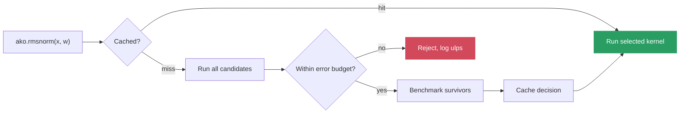
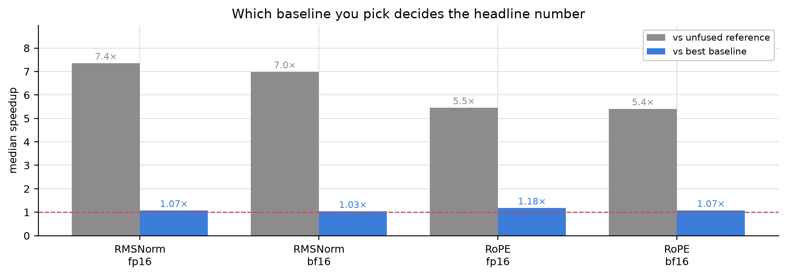
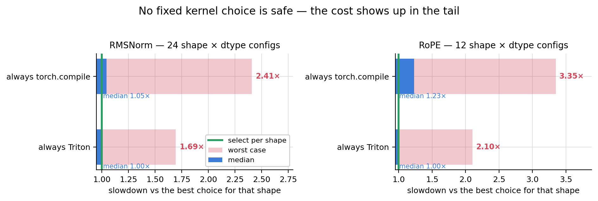
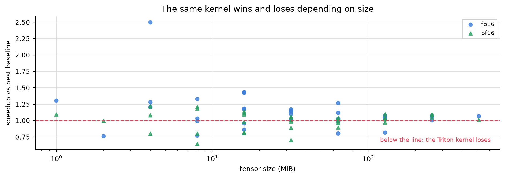

# AKO — Adaptive Kernel Optimizer

**A validation harness for swapping GPU kernels in an LLM inference stack.**
It benchmarks candidate kernels per shape and dtype, checks numerical agreement
on validation inputs before using them, and records why every decision was made.
These checks are not a proof for all possible inputs.

[](https://github.com/Farx1/AKO/actions/workflows/ci.yml)
[](LICENSE)
[](https://www.python.org)

---

## The problem

You write a fused Triton kernel for RMSNorm. On your shapes it is 5× faster than
PyTorch. You ship it.

Three things then happen that nothing in your workflow catches.

**It is not faster everywhere.** On an RTX 3070 Laptop GPU, across 24 shape × dtype
configurations, that same kernel *loses* to the best PyTorch baseline on 12 of them —
by up to 1.69× (it takes 69 % longer).
A kernel is fast for a memory access pattern, not for an operation, and serving
workloads do not hold their shapes still: prompt lengths vary per request, dynamic
batching moves the batch dimension, and prefill and decode are two different
regimes on the same weights.

**It can be silently wrong.** Autotuning `BLOCK_SIZE` over a config list that tops
out at 8192 truncates every row wider than that. The kernel does not crash. It
does not warn. It returns a plausible tensor with a wrong tail — and it wins the
benchmark, because doing less work is faster. Autotuners rank by speed; nothing
ranks by correctness.

**Your correctness check is probably wrong too.** The obvious guard is
`max_abs_error < 1e-2`. In bf16, around magnitude 5, the gap between two
representable values is already `2^-5 = 0.031`. A *correct* kernel that rounds to
the neighbouring value fails that check. We hit exactly this: a kernel off by
**1.00 ulp** — the smallest possible disagreement — was rejected, and the system
fell back to the slow path with no signal beyond a number in a log.

The gap is not "we need faster kernels". It is that **kernel substitution has no
numerics contract**.

## What AKO does

```python
import torch, ako

x = torch.randn(8, 2048, 4096, dtype=torch.float16, device="cuda")
w = torch.ones(4096, dtype=torch.float16, device="cuda")

y = ako.rmsnorm(x, w)   # picks the best *correct* kernel for this shape+dtype
```

On the first call for a given `(operation, GPU, shape, dtype)`, AKO runs every
registered candidate, **rejects any whose output drifts beyond a dtype-scaled
budget**, benchmarks the survivors, and caches the decision with the metrics that
justified it.



The gate itself is an absolute-error budget, `atol + rtol(dtype) × max|reference|`
(`ako/validation/numerical.py`). Rejection messages also report the error in
**ulps**, so the number reads the same in fp32, fp16 and bf16: 1 ulp is a rounding
disagreement, a genuinely wrong kernel counts in the thousands.

The PyTorch baseline is always a candidate. Selection minimizes measured latency
among surviving candidates; it does not guarantee performance on future inputs or
in a different execution context. A candidate that raises is dropped, not propagated.

```jsonc
// ~/.ako/kernel_cache.json — every decision is auditable (illustrative values)
{
  "kernel": "rmsnorm_triton",
  "latency_p50_ms": 0.319,
  "best_baseline_ms": 0.341,
  "best_baseline_kernel": "rmsnorm_compiled",
  "speedup_vs_best_baseline": 1.07,
  "max_error": 0.00195,
  "error_budget": 0.0234,
  "backend": "triton"
}
```

## Why not just use `torch.compile` / vLLM / TensorRT-LLM?

You probably should — for speed. They are faster, broader, and battle-tested, and
this project does not compete with them.

What they do not give you is a **gate**. `torch.compile` and Triton's autotuner
select by latency; neither refuses a candidate for being numerically wrong, and
neither reports how wrong it is in a unit you can reason about. If you are writing
custom kernels — a Triton op in a vLLM fork, a quantization path, a port to new
hardware — that gate is what stops a fast-but-wrong kernel from reaching
production. AKO is the harness around that step, not a replacement for the
runtime.

## Measured results

Full campaign in [`docs/RESULTS.md`](docs/RESULTS.md), raw JSON in
`reports/rtx3070/`. Hardware: RTX 3070 Laptop, PyTorch 2.6 + CUDA 12.4, WSL2.

**Every baseline is in the race** — unfused reference, PyTorch's fused
`rms_norm`, and `torch.compile`. RoPE has no fused primitive in PyTorch, so
`torch.compile` is its only honest baseline.

| Operation | vs unfused reference | **vs best baseline** | Triton loses on |
|-----------|---------------------:|---------------------:|-----------------|
| RMSNorm fp16 | 7.01× | **1.01×** | 6 / 12 shapes |
| RMSNorm bf16 | 7.65× | **1.01×** | 6 / 12 shapes |
| RoPE fp16 | 3.99× | **1.16×** | 2 / 6 shapes |
| RoPE bf16 | 4.67× | **1.23×** | 2 / 6 shapes |

*(medians; the best baseline is `torch.compile` on 34 of 36 configs. Shapes include
decode-sized `seq_len = 1` rows.)*



**Read the middle column, not the left one.** Beating an unfused reference by 7×
mostly measures the intermediates it materializes (~40 bytes of traffic per
element against ~4 for a fused kernel). Against what PyTorch already ships, the
real gain is **1.0×–1.2×**, and it is a coin flip per shape.

**The right column is the actual finding.** No single kernel wins everywhere.



| Strategy | Median | Geometric mean | **Worst case** |
|----------|-------:|---------------:|---------------:|
| RMSNorm: always Triton | 1.00× | 1.13× | **1.69×** |
| RMSNorm: always `torch.compile` | 1.03× | 1.17× | **2.41×** |
| RMSNorm: always `F.rms_norm` | 6.95× | 5.36× | 11.90× |
| RoPE: always Triton | 1.00× | 1.23× | **2.10×** |
| RoPE: always `torch.compile` | 1.23× | 1.37× | **3.35×** |
| **select per shape** | **1.00×** | **1.00×** | **1.00×** |

*(slowdown against the fastest measured kernel for each shape × dtype; 24 RMSNorm
and 12 RoPE configs)*

Ship one hand-written kernel everywhere and some shapes run up to 2.1× slower
than they could. Trust `torch.compile` everywhere and RoPE runs up to 3.35×
slower. The
value is in the tail, not the median — and the dispatcher demonstrates it by
arbitrating against itself: on the fp16 workload it selects
`rmsnorm_residual_compiled`, the `torch.compile` baseline, over its own Triton
kernel.

And there is no shortcut rule to replace the measurement. Plotting the same
kernel's speedup against problem size gives a cloud, not a threshold: in bf16 it
runs at 1.42× the best baseline at 4 MiB and at 0.67× at 8 MiB.



### Negative results, published

- **Decode is a regression**: 0.65× against a compiled stack (AKO 12.23 ms vs
  `torch.compile` 7.94 ms per step, eager 10.06 ms). The selector benchmarks at
  decode shapes and still picks Triton, so the per-call benchmark disagrees with
  the loop. `launch_overhead_ms` is recorded per backend, but the committed values
  are clamped at 0 and do not settle it yet. Unresolved.
- **Prefill gain is against a possibly handicapped baseline**: AKO 9.04 ms,
  `torch.compile` 11.16 ms, eager 11.69 ms (1.24× vs the best). Dynamo hits
  `cache_size_limit` on `KVCache.update` and recompiles, so the compiled baseline
  may be slower than it should be and the 1.24× may be optimistic. Not yet fixed.
- **Adaptive selection loses the serving simulation.** On a 64-request trace
  (`reports/rtx3070/serving_simulation.json`) the adaptive policy takes
  28 613 ms against 26 054 ms for plain eager (+9.8 %), and its TTFT p50 is
  329 ms against 54 ms. Eager is the best policy on that trace.
- **End-to-end impact is small.** The operations AKO covers are ~24 % of a decoder
  stack's time. A 1.05× on that share is ~1 % overall. This is a study and a
  harness, not a speedup.

## What this is not

- **Not a fast inference server.** Use vLLM, SGLang or TensorRT-LLM.
- **Not a kernel library.** Four dispatched operations: RMSNorm, fused residual+RMSNorm,
  RoPE, SwiGLU.
- **Not multi-vendor.** NVIDIA + CUDA. AMD/ROCm is detected and refused, not supported.
- **Not attention or a production GEMM** — the parts that actually dominate inference
  time. `ako/search/kernels/mm_fused.py` is an experimental GEMM-with-epilogue
  template for the search harness, not a dispatched operation.

## How it works

| Module | Role |
|--------|------|
| `ako/ops/` | Reference, `torch.compile` and Triton implementations per operation |
| `ako/dispatcher/` | Hardware detection, registry, selector, persistent cache |
| `ako/validation/` | dtype-scaled error budgets, ulp accounting |
| `ako/benchmark/` | CUDA-event timing, reports |
| `ako/models/` | LLaMA-shaped decoder stack (GQA, SwiGLU, KV cache) + HF checkpoint loader |
| `ako/experiments/` | Serving trace simulation, policy comparison |

The selector implements Algorithm 1 of the accompanying
[paper](adaptive_kernel_optimizer_paper.md): cache → validate → benchmark → cache.

**The tolerance scales with the dtype and the data.** `error_budget()` returns
`atol + rtol × max|reference|`, with `rtol` taken from a per-dtype table
(`DTYPE_RTOL`). The gate compares the absolute error to that budget; the error in
ulps is only reported in the rejection message, where 1 ulp is a rounding
disagreement and a genuinely wrong kernel counts in the thousands.

### Testing GPU kernels without a GPU

`tests/test_triton_interpreter.py` runs the Triton kernel bodies through
`TRITON_INTERPRET=1` and compares them to the PyTorch references — indexing,
masking, interleaved RoPE pairs, dtype rounding. One check uses a row wider than
the old autotune ceiling: under the previous configuration it reports an error of
3.14 instead of 1e-7, so the truncation bug now has a regression test that runs on
a laptop.

The decoder stack is checked against `transformers`' own LLaMA implementation
offline — in fp32 the forward pass agrees to within 1e-5 in prefill and 1e-4
in cached decoding (max absolute error), which is what pins down the RMSNorm placement, RoPE pairing and GQA
conventions.

## Getting started

Requires Linux or WSL2, Python 3.11+. An NVIDIA GPU is needed for the Triton
kernels; everything else runs on CPU.

```bash
git clone https://github.com/Farx1/AKO.git && cd AKO
bash scripts/setup.sh && source .venv/bin/activate
python scripts/check_environment.py
```

```bash
pytest -q -m "not gpu"    # 167 tests, no GPU required
pytest -q -m gpu          # 24 tests, CUDA + Triton
```

### Reproducing the measurements

```bash
# everything below, plus report generation
AKO_ENABLE_COMPILE=1 bash scripts/run_gpu_validation.sh
```

```bash
# per-operation sweeps
python scripts/benchmark_rmsnorm.py --device cuda --output-dir reports/
python scripts/benchmark_rope.py --device cuda --style neox --output-dir reports/

# kernel selection for one workload -> selected_config.json
python scripts/optimize_model.py --device cuda --dtype fp16 \
    --batch-size 8 --seq-len 2048 --hidden-dim 4096 --output-dir reports/

# end-to-end decoder stack, eager vs torch.compile vs AKO
python scripts/profile_model.py --device cuda --dtype fp16 --output-dir reports/

# serving trace: eager / compile / always-Triton / adaptive on identical work
python scripts/simulate_serving.py --device cuda --dtype fp16 \
    --requests 128 --max-batch 8 --output-dir reports/
```

The serving simulation replays a request trace with lognormal prompt lengths —
the right skew of a real workload is what keeps shapes moving — and reports the
**autotuning amortization point**: the batch at which adaptive selection has
earned back what it spent benchmarking.

### Using it

```python
import torch, ako

# RMSNorm, and the residual-add fused into it (the transformer block pattern)
y = ako.rmsnorm(x, weight)
normed, residual = ako.rmsnorm_residual(x, residual, weight)

# RoPE on (batch, seq_len, n_heads, head_dim)
cos, sin = ako.build_rope_tables(2048, 128, device="cuda")
q = ako.rope(q, cos, sin)                  # "neox" (HF LLaMA)
q = ako.rope(q, cos, sin, "interleaved")   # GPT-J
```

| Variable | Default | Role |
|----------|---------|------|
| `AKO_AUTOTUNE` | `1` | `0` pins everything to the PyTorch baseline |
| `AKO_CACHE_PATH` | `~/.ako/kernel_cache.json` | Where decisions persist |
| `AKO_ENABLE_COMPILE` | unset | Include `torch.compile` baselines (slow first call) |

Load real weights after `pip install -e ".[hf]"` (the package is not on PyPI):

```python
from ako.models import load_hf_model
stack = load_hf_model("TinyLlama/TinyLlama-1.1B-Chat-v1.0", device="cuda")
```

## Status

The accompanying paper scopes four operations. Two are implemented, and the two
that dominate inference time are not.

| Operation | Share of a decoder's time | Status |
|-----------|--------------------------|--------|
| RMSNorm (+ fused residual) | ~15 % | ✅ reference, Triton, `torch.compile`, validated |
| RoPE | ~9 % | ✅ `neox` + `interleaved`, validated |
| Quantized INT8/INT4 matmul (paper §9) | ~50 % | ❌ not started |
| IO-aware attention (paper §10) | ~25 % | ❌ not started |

That table is the honest answer to "how far along is this": the harness, the
validation discipline and the measurement methodology are done and tested; the
operations that would make the end-to-end number matter are not. This is why the
overall impact is ~1 % rather than something worth deploying.

### Toward a library

The package installs (`pip install -e .`) and the dispatch API is stable, but it
is not yet something to depend on:

| | Status |
|---|--------|
| Public API (`ako.rmsnorm`, `ako.rope`, …) | ✅ stable, typed, documented |
| Kernel registry open to third-party kernels | ✅ `KernelEntry` contract in [`docs/EXTENDING.md`](docs/EXTENDING.md) |
| Published on PyPI | ❌ install from git only |
| Semantic versioning + changelog | ⚠️ [`CHANGELOG.md`](CHANGELOG.md), semver from `0.2.0`; no release or tag yet |
| Hardware coverage | ⚠️ one GPU measured |
| `ako.models` / `ako.experiments` | ⚠️ research scaffolding, not library surface |

The extension point is the piece that decides whether this becomes a library
someone else uses: registering your own kernel as a candidate and letting the
harness prove it correct before it runs. That path is exercised by the tests and
documented in [`docs/EXTENDING.md`](docs/EXTENDING.md).

Known gaps: the decode and serving regressions are unexplained; and a single GPU has been measured, so nothing is
claimed about portability across hardware — which is precisely the claim the
design exists to support.

## Research: precision between composed blocks

[Boundary-precision study](docs/RESEARCH_PRECISION_BOUNDARIES.md): actual Triton
interpreter executions expose a cancellation case where fused and unfused blocks
return 1 and 0. An optional fp32 boundary repairs the discrepancy. The report
includes the derivation, 171 executions, related work and the GPU validation plan;
it makes no GPU performance claim.

## About

Built by **Jules Barth** — M2 Data & AI Engineering, ESILV (Paris) — alongside a
short paper on adaptive kernel selection ([`adaptive_kernel_optimizer_paper.md`](adaptive_kernel_optimizer_paper.md)).

- Portfolio: https://julesbarth-myportfolio.fr
- LinkedIn: https://www.linkedin.com/in/jules-barth

## License

MIT
