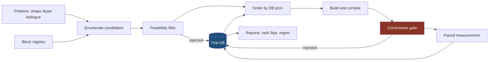

# AKO architecture

Status: design document for the next version of AKO. It supersedes nothing that
runs today; the existing rmsnorm/rope/swiglu dispatch path is untouched by it.

Target hardware for every number in this document: one RTX 3070 (GA104, compute
capability 8.6, 46 SMs, 8 GB, 448 GB/s, 4 MB L2, 99 KB opt-in shared memory per
block). No `sudo`, so clocks cannot be locked with `nvidia-smi -lgc`.

**Scope limit, fixed 2026-08-13: that one card is the only card this project will
ever measure.** No second GPU is rented or borrowed. Every statement about how a
ranking generalizes to another GPU is therefore an *unmeasured hypothesis of this
work*, never a result. The GPU stays in the keys, the schema and the invariants
because dropping it would hide that assumption instead of exposing it.

---

## 1. The problem

### 1.1 What we want

Given an operation, a shape, a dtype and a GPU, produce the fastest *correct*
kernel, by composing implementation blocks whose relative performance depends on
that context — and be able to answer, for a shape never measured before, which
candidate to try first. The GPU here is a *key*, not a measured axis: shape and
dtype are varied and measured, the GPU is held fixed at one 3070 (scope limit
above).

### 1.2 What already exists, named

| System | What it already does | Consequence for AKO |
|---|---|---|
| `torch.compile` / Inductor | Greedy pairwise fusion (`Scheduler.fuse_nodes` scores candidate pairs and fuses the best repeatedly), Triton GEMM templates under `max_autotune`, `MultiTemplateBuffer` carrying top-N GEMM candidates into scheduling so fused-vs-unfused is benchmarked, `FXGraphCache` + autotune cache keyed on graph and device capability | "We search fusions instead of greedy" is not a differentiator. For MatMul+Bias+Act the composition space has 4 members and greedy finds the right one. |
| cuBLASLt (via `torch._addmm_activation`) | A fixed fused-epilogue enum: `BIAS`, `RELU`, `GELU`, `RELU_BIAS`, `GELU_BIAS`, and the backward variants. Note: `torch.addmm` does **not** reach the activation epilogues — ATen routes it to `gemm_and_bias` with `CUBLASLT_EPILOGUE_BIAS` only. `matmul+bias+act` in one vendor call requires `torch._addmm_activation` (present in the installed torch), which Inductor emits by pattern matching. | The stated MVP op is *already* one fused vendor kernel, **through `torch._addmm_activation`**. "AKO fuses it" is not a result. The baseline to beat is that call; measuring against `torch.addmm` + a separate activation would be measuring against the weaker path. |
| Triton `@triton.autotune` | Config search over a user-authored list, keyed on chosen shape values | Its cache is an in-process Python dict on the `JITFunction`, no correctness check, no cross-process persistence. This is the one place AKO's DB is a real gap — and only against Triton, never against Inductor or TensorRT. |
| TVM / Ansor / MetaSchedule | Full schedule-space search with a learned cost model | Already built, and it lost on cost: 214–295 min of tuning per network in the published tables, no dynamic-shape support. AKO inherits both failure modes unless the search budget is a hard parameter from day one. |
| TensorRT | Shape buckets (optimization profiles), per-profile tactic selection, serializable timing cache | Shape bucketing is not novel as a mechanism. The measured bucket *boundaries* would be. |
| Mirage (OSDI'25) | Superoptimization over kernel/block/thread graphs with probabilistic equivalence checking | AKO's composition space is a strict subset. The architecture contribution is taken. |
| Helion | One kernel description to hundreds of autotuned Triton lowerings, ~10 min/kernel | Do not write a variant DSL. That slot is occupied. |

### 1.3 The parts of the stated target that are losing reimplementations

Written plainly, because pretending otherwise costs months:

- **A custom program IR.** `torch.fx.Graph` + `FakeTensor` already carry ops,
  dependencies, shapes, dtypes and layouts. Building `ako/ir/graph.py` buys a
  graph datastructure that will contain exactly one shape of graph.
- **A hand-written library of tiling strategies.** Tiling is a parameter vector
  over one template, not a family of blocks. Inductor's `mm_configs` and Helion
  both already generate them.
- **A bespoke timing and comparison harness.** `ako/benchmark/bench_op.py`
  already does batched CUDA-event timing, run-to-run p50s, CV, peak memory,
  seeded bootstrap CIs and interleaved paired comparison. `torch.testing` and
  `ako/validation/numerical.py` already do dtype-scaled comparison.
- **Multi-GPU, MLIR/CUDA backends, an agentic layer.** Not in this plan at all.
- **"Beat cuBLAS on large square fp16 GEMM."** Computed, not assumed: `tl.dot`
  accumulates in fp32 by default, and GA10x runs fp16 tensor ops at half rate
  with fp32 accumulate — so the ceiling reachable from Triton on this card is
  5888 × 2 × 1.725 GHz × 2 = **40.6 TFLOP/s**, not the 81.3 on the spec sheet.
  cuBLAS lands 55–65% of that at 4096³ and a good Triton GEMM lands 85–95% of
  cuBLAS. Target parity there and say so.

### 1.4 The hole

Every performance cache in the stack is **exact-key memoization**: Inductor's
`FXGraphCache`/autotune cache (graph hash + device capability), Triton's
in-memory dict, TensorRT's timing cache (layer + tactic). Ansor's XGBoost cost
model is per-task and discarded after tuning. **Nothing publishes how the
ranking of implementations moves across shape, dtype and GPU**, and nothing
predicts a ranking for a shape it has not measured.

Of that gap, only the **shape** and **dtype** axes are measurable here, and both
are. The **GPU axis is NOT TESTED**: it was in scope until 2026-08-13 and is out
of scope now that a second card is ruled out, so "how the ranking moves across
GPUs" is named as an open gap in the literature, never as something this work
closes.

What remains is the only defensible claim available, and it is measurable on one
3070.

### 1.5 The claim, as one falsifiable sentence

> For `MatMul → Bias → Activation` on one RTX 3070, the top-1
> `(composition, variant)` changes across the `(M, N, K)` grid **and between fp16
> and bf16 at the same shape**; a prior fitted on the trial database selects a
> candidate within 5% of the measured best while benchmarking ≤5 candidates, and
> beats the nearest-measured-shape baseline.

The nearest-measured-shape baseline is mandatory. Without it the claim is
unfalsifiable.

The sentence quantifies over shape and dtype only, never over GPUs, so it stays
falsifiable under the single-card constraint: the shape half is measured by the
fp16 grid (ROADMAP M7), the dtype half by the bf16 pass over the same grid
(ROADMAP M9). Both run on the same card, so an inversion is a property of
`(shape, dtype)` and not of hardware.

The inter-hardware version of the same claim — *the top-1 flips between an
RTX 3070 and a different GPU* — was considered and is **NOT TESTED**. It needs a
second card; as of 2026-08-13 the project has exactly one and will not acquire
another. It is not restated as a result anywhere in this document.

Secondary, and equally publishable if it comes back zero: **the fraction of grid
cells where AKO's pick beats `torch.compile(mode="max-autotune")` by >10%.**

### 1.6 Where the winnable region is, computed before writing a kernel

Machine balance: 40.6e12 / 448e9 ≈ **90.6 FLOP/byte**.

| Shape family | Arithmetic intensity | Expectation (hypothesis, to be measured) |
|---|---|---|
| M=N=K=4096 | 137.44 GFLOP / 100.66 MB ≈ 1365 FLOP/B | Deeply compute-bound. Fusion cuts traffic 234.88 → 100.66 MB (−57%) but saves 134.22 MB / 448 GB/s = 300 µs off a ~6.9 ms kernel: **4% wall clock**. Parity target. |
| M ≤ 64, N=K=4096 | ≈ 1 FLOP/B | Bandwidth-bound, 90× below the ridge. Floor is 33.55 MB / 448 GB/s = 74.9 µs. Fusion saves 24 KB — the entire visible gain is 2 kernel launches and it disappears under CUDA graphs. Split-K is the only lever that can win here. |
| M=N=4096, K=64 | 2.15 GFLOP / 34.6 MB ≈ 62 FLOP/B | Traffic 168.82 → 34.60 MB (−79.5%) against 107 µs of compute. Predicted ~3.8× versus eager. **The only honest large fusion win on this card.** |

Two card-specific effects are expected to drive the ranking:

- **99 KB shared memory per block.** `num_stages × (BLOCK_M + BLOCK_N) × BLOCK_K
  × itemsize`; `BM=BN=128, BK=64, stages=4` needs 131072 B and cannot run. Over a
  720-point `BLOCK_M × BLOCK_N × BLOCK_K × warps × stages` grid, 441 fit — a 39%
  cut for zero compile cost.
- **46 SMs (not a power of two).** At M=N=1024, 128×128 tiles give 64 tiles over
  46 SMs = 2 waves at 70% utilization, while 64×128 gives 128 tiles at 93%. The
  **harness self-test is this direction only**: at 1024² the wave model predicts
  64×128 ahead of 128×128, so measuring the opposite ordering means the timing
  path is wrong, not that the thesis is wrong. The expected flip back at 4096² is
  **not** predicted by wave quantization — 128×128 gives 1024 tiles / 46 = 23
  waves at 97.0% and 64×128 gives 2048 / 46 = 45 waves at 98.9%, so the wave
  model still marginally favours 64×128 there. Any flip back at 4096² is driven
  by data reuse and L2 traffic, a different mechanism, and is a *hypothesis to
  measure*, not a first-principles prediction.

---

## 2. Architecture retained

**The product is the trial database and the budgeted search loop around it, not
the code generator.** One parameterized Triton template plus torch/cuBLASLt/
Inductor blocks is already a rich enough candidate space to produce a falsifiable
rank-inversion map. Every later capability is a new row source or a new query
against the same schema.

Three decisions carry the design:

1. **No IR.** A `Problem` and a `Candidate` are hashable dataclasses that exist
   to be the primary key of the DB. `torch.fx` is deferred until a second op
   family exists.
2. **`tl.constexpr` is the template engine.** The epilogue chain is three
   constexpr integer codes on one kernel; untaken branches are dead-code
   eliminated before PTX, and Triton's own binary cache is the variant cache. No
   jinja, no string splicing, no `exec` of generated source.
3. **`torch.compile` is a block, not a baseline script.** Inductor's default,
   `max-autotune` and `reduce-overhead` modes are enumerated as candidates, pass
   the same correctness gate, are timed with the same paired comparator, and land
   in the same table. "Where does AKO beat the shipped compiler" is then a SQL
   query, not an argument.



The only edge that is not obvious: **the DB feeds back into ordering and
pruning, and nowhere else.** The search loop has no other channel into history,
so any claim about transfer is reproducible by re-running one query against the
shipped `.sqlite`.

---

## 3. Core data structures

### 3.1 The key: what to compute, how to compute it, on what

```python
# ako/search/spec.py
from dataclasses import dataclass
from typing import Literal
import hashlib, json

DType = Literal["fp16", "bf16", "fp32"]
Act = Literal["none", "relu", "gelu_tanh", "silu"]


@dataclass(frozen=True, slots=True)
class Problem:
    """WHAT to compute. Deliberately not a graph: no producers, no consumers."""
    op: str = "matmul_bias_act"
    m: int = 1
    n: int = 4096
    k: int = 4096
    dtype: DType = "fp16"
    act: Act = "gelu_tanh"
    bias: bool = True
    layout: str = "nn"                      # "nn" | "nt"

    def chain(self) -> tuple[str, ...]:     # ("matmul", "bias", "act")
        ...
    def key(self) -> str: ...
    def flops(self) -> int: ...             # 2 * m * n * k
    def itemsize(self) -> int: ...          # 2 for fp16/bf16, 4 for fp32


@dataclass(frozen=True, slots=True)
class Candidate:
    """HOW to compute it. One compilable point in the search space."""
    composition: str                        # "mm+bias+act" | "mm+bias|act"
                                            # | "mm|bias+act" | "mm|bias|act"
    blocks: tuple[str, ...]                 # one block name per segment
    params: tuple[tuple[tuple[str, object], ...], ...]   # per-block sorted kv pairs

    def hash(self) -> str:                  # sha1 of canonical json, 16 hex chars
        ...


@dataclass(frozen=True, slots=True)
class DeviceCaps:
    """Built from torch.cuda.get_device_properties, wrapping the existing
    ako.dispatcher.hardware.get_device_info."""
    name: str                               # "NVIDIA GeForce RTX 3070"
    cc: tuple[int, int]                     # (8, 6)
    sm_count: int                           # 46
    smem_per_block: int                     # 101376 -> shared_memory_per_block_optin
    regs_per_sm: int
    l2_bytes: int
    total_mem_gb: float
    torch_version: str
    triton_version: str | None

    @property
    def key(self) -> str: ...               # "NVIDIA_GeForce_RTX_3070_cc86"
```

Note the four compositions. The target document lists three; `mm|bias+act` — an
unfused Triton GEMM followed by a *fused* elementwise tail kernel — is a distinct
candidate and is not the same kernel pair as eager `addmm` + `F.gelu`.

### 3.2 The GEMM variant parameters

These are the `params` of the `triton_mm*` blocks and, at the same time, the
constexpr tuple Triton specializes on.

```python
BLOCK_M:    Literal[16, 32, 64, 128, 256]
BLOCK_N:    Literal[32, 64, 128, 256]
BLOCK_K:    Literal[32, 64, 128]
GROUP_M:    Literal[1, 8]                   # L2 swizzle
SPLIT_K:    Literal[1, 2, 4, 8, 16]         # reclaims idle SMs when M is small
num_warps:  Literal[2, 4, 8]
num_stages: Literal[2, 3, 4, 5]
ACC_FP16:   bool                            # fp16 accumulate: 2x ceiling on GA10x
```

`ACC_FP16` is a first-class variant, not a tuning knob. It doubles the
theoretical ceiling (40.6 → 81.3 TFLOP/s) and buys that with precision, which is
exactly the trade the correctness gate exists to arbitrate. Its relaxed tolerance
multiplier is stored **per trial row**, so a reader can see which wins were
bought with numerics.

### 3.3 A block

Metadata plus three callables. Not a class hierarchy, not a DSL.

```python
# ako/search/blocks.py
Params = dict[str, int | str | bool]

@dataclass(frozen=True)
class Block:
    name: str
    covers: frozenset[str]                  # {"matmul"} | {"matmul","bias","act"} ...
    supports: Callable[[Problem, DeviceCaps], bool]
    grid:     Callable[[Problem, DeviceCaps], Iterator[Params]]
    feasible: Callable[[Params, Problem, DeviceCaps], str | None]  # None = keep
    build:    Callable[[Problem, Params], Callable[..., torch.Tensor]]
    compiles: bool = False                  # build() cost charged to compile_ms
    cost_class: Literal["free", "jit", "autotune"] = "free"
    max_build_s: float = 30.0               # hard per-candidate build timeout
    nondeterministic: bool = False          # e.g. SPLIT_K>1 atomic accumulation
```

Three fields exist because of measured failure modes, not for symmetry:

- **`cost_class` / `max_build_s`.** `torch_compile(mode="max-autotune")` runs
  Inductor's own exhaustive Triton GEMM autotune per new shape — minutes, not the
  ~1.9 s the cost model assumes for an ordinary candidate. One such candidate
  would consume an entire `budget_s=180` cell. Build time is therefore charged to
  a separate `compile_budget_s`, never to the measurement budget, and a build
  exceeding `max_build_s` is recorded `verdict='compile_error'`,
  `reason='build_timeout'`. All `cost_class="autotune"` candidates are
  pre-compiled for the whole grid in one **unmeasured warm pass** before the
  sweep, with `TRITON_CACHE_DIR` and `TORCHINDUCTOR_CACHE_DIR` pinned; the warm
  pass wall clock is reported as part of search cost (invariant 7).
- **`nondeterministic`.** Split-K accumulates through `atomic_add`, so the
  reduction order varies run to run and `max_abs_err` is not reproducible between
  the gate run and the timed run. Invariant 1 treats a verdict as permanent, so
  such a candidate would otherwise be blacklisted or accepted by a coin flip. See
  the repeated-gate rule in invariant 1.

`covers` is what makes a new op family a registration rather than a composer
edit: segment matching is `set(segment) <= block.covers`.

MVP block set — seven entries, one Triton source file:

| name | covers | params |
|---|---|---|
| `torch_eager` | matmul, bias, act | — |
| `torch_addmm` | matmul, bias | — (cuBLASLt `BIAS` epilogue only) |
| `torch_addmm_act` | matmul, bias, act | — (`torch._addmm_activation`; the cuBLASLt `RELU_BIAS`/`GELU_BIAS` epilogue. `supports()` is false for `act ∉ {relu, gelu_tanh}` or `bias=False`. This is the strongest vendor baseline and must be in the candidate set.) |
| `torch_elementwise` | bias, act | — (tail kernel for unfused compositions) |
| `torch_compile` | matmul, bias, act | `mode ∈ {default, max-autotune, reduce-overhead}` |
| `triton_mm` | matmul | full config grid, epilogue constexprs off |
| `triton_mm_fused` | matmul, bias, act | full config grid, epilogue constexprs on |

### 3.4 The epilogue vocabulary

One dict, shared by the GEMM epilogue, the tail kernel and the fp32 oracle — so
the reference and the kernel cannot drift apart.

```python
EPI_CODES = {"none": 0, "bias": 1, "relu": 2, "gelu_tanh": 3, "silu": 4}

@triton.jit
def apply_epi(acc, ptr, offs_n, mask_n, CODE: tl.constexpr):
    if CODE == 1:
        acc = acc + tl.load(ptr + offs_n, mask=mask_n, other=0.0).to(tl.float32)[None, :]
    elif CODE == 2:
        acc = tl.maximum(acc, 0.0)
    elif CODE == 3:
        # tanh(x) == 2 * sigmoid(2x) - 1. Deliberate: `tl.math.tanh` does NOT
        # exist in the installed Triton 3.7.1 (tl.math exposes only abs/ceil/cos/
        # div_rn/erf/exp/exp2/fdiv/floor/fma/log/log2/rsqrt/sin/sqrt/sqrt_rn/
        # umulhi); tanh moved to triton.language.extra.libdevice, and libdevice
        # calls fail under TRITON_INTERPRET=1 with "cannot convert None of type
        # NoneType to tensor". Since gelu_tanh is the default `act` and the act
        # of the whole M7 grid, using libdevice would make the CPU interpreter
        # harness — the thing that makes days without a GPU productive — unable
        # to run the only activation this project measures. tl.sigmoid,
        # tl.maximum, tl.dot and tl.atomic_add all work in the interpreter.
        u = 0.7978845608 * (acc + 0.044715 * acc * acc * acc)
        acc = 0.5 * acc * (2.0 * tl.sigmoid(2.0 * u))       # 1 + tanh(u)
    elif CODE == 4:
        acc = acc * tl.sigmoid(acc)
    return acc
```

Rule: **no epilogue primitive that the interpreter cannot execute.** Any addition
to `EPI_CODES` must be expressible in the interpreter-supported set, or it is not
covered by the CPU harness and its milestone hours cannot be budgeted as [CPU].

### 3.5 The trial database

SQLite from the stdlib, one append-only file at `reports/rtx3070/trials.sqlite`.
Two tables, because a whole sweep must be excludable by a join instead of a
delete.

```sql
CREATE TABLE IF NOT EXISTS sweep (
  id        TEXT PRIMARY KEY,          -- uuid4 hex
  started   TEXT NOT NULL, finished TEXT,
  budget_s  REAL, drift_pct REAL,
  status    TEXT,                      -- ok | budget_exhausted | drifted | aborted
  host TEXT, gpu TEXT, git_sha TEXT, notes TEXT
);

CREATE TABLE IF NOT EXISTS trial (
  id INTEGER PRIMARY KEY, ts TEXT NOT NULL,
  sweep_id TEXT NOT NULL REFERENCES sweep(id),

  -- problem key. shape_json is authoritative; m/n/k are denormalized so the
  -- nearest-shape query is a range scan and not a json parse.
  op TEXT, shape_json TEXT NOT NULL, m INTEGER, n INTEGER, k INTEGER,
  dtype TEXT, act TEXT, bias INTEGER, layout TEXT,

  -- candidate key
  cand_hash TEXT NOT NULL, composition TEXT NOT NULL,
  blocks TEXT NOT NULL, params TEXT NOT NULL,   -- json, sorted keys

  -- hardware key: never omitted, so "tune once ship everywhere" is inexpressible
  gpu TEXT, cc TEXT, sm_count INTEGER,
  torch_version TEXT, triton_version TEXT, driver TEXT,
  toolchain_key TEXT NOT NULL,  -- sha1(torch_version|triton_version|driver)[:12]

  -- correctness, always written before any perf column
  verdict TEXT NOT NULL,        -- ok|incorrect|nan|infeasible|compile_error|oom
                                -- |oracle_overflow
  reason TEXT, max_abs_err REAL, err_ulps REAL, budget REAL,
  tol_scale REAL, seeds TEXT,
  gate_runs INTEGER, stochastic INTEGER,   -- >1 run and pessimistic verdict for
                                           -- nondeterministic blocks
  magnitudes_json TEXT,         -- per-magnitude-case result, not one collapsed
                                -- verdict: [{target_abs_c, scale, verdict, err}]

  -- performance
  wall_p50_ms REAL, wall_p95_ms REAL, gpu_p50_ms REAL, cv REAL, iqr_ms REAL,
  peak_mem_mb REAL, compile_ms REAL, inner_iters INTEGER, l2_state TEXT,
  graph_captured INTEGER,       -- decode rows are reported both ways
  incumbent_hash TEXT, incumbent_p50_ms REAL,   -- which incumbent the ratio is
                                                -- against; see below
  speedup_vs_incumbent REAL, ci_lo REAL, ci_hi REAL, significant INTEGER,

  -- machine state at measurement time
  sm_clock_mhz INTEGER, temp_c INTEGER, power_w REAL
);

CREATE INDEX IF NOT EXISTS ix_trial_problem ON trial(op,dtype,act,m,n,k,gpu);
CREATE INDEX IF NOT EXISTS ix_trial_cand    ON trial(cand_hash,gpu,dtype);
CREATE INDEX IF NOT EXISTS ix_trial_verdict ON trial(verdict,gpu,dtype);
```

Six methods, no more:

```python
class TrialDB:
    def begin_sweep(self, prob, caps, budget_s) -> str: ...
    def end_sweep(self, sweep_id, *, drift_pct, status) -> None: ...
    def record(self, sweep_id, prob, cand, caps, *, verdict, **cols) -> None: ...
    def blacklist(self, caps, dtype, toolchain_key) -> set[str]:
        """cand_hash with verdict in (incorrect, nan, compile_error) on this
        GPU+dtype+toolchain_key. Never 'infeasible', 'oom' or 'oracle_overflow'."""
    def neighbours(self, prob, caps, *, limit=3) -> list[tuple[Problem, list[tuple[str, float]]]]:
        """Measured problems nearest in log-(m,n,k), with their ranked candidates."""
    def fit_features(self, op, dtype, gpu, toolchain_key) -> tuple[np.ndarray, np.ndarray]:
        """Design matrix and target for the deferred lstsq prior. The target is
        log(speedup_vs_incumbent) against the sweep's frozen incumbent — a paired
        ratio, not log(wall_p50_ms). Absolute latency is not usable as a fit
        target on a card with unlockable clocks (see M1's decision: if drift is
        ≥5% every milestone reports paired ratios only), and a paired ratio is
        invariant to clock state by construction. Rows whose incumbent_hash is
        not the sweep's frozen incumbent are excluded."""
```

- **How it prunes:** `blacklist()` removes every candidate already proven
  *wrong* for this GPU+dtype+toolchain *at any shape* — a numerically broken
  `ACC_FP16`/`SPLIT_K` combination is eliminated forever after one measurement.
  It is deliberately **not** `verdict != 'ok'`: `infeasible`, `oom` and
  `oracle_overflow` are shape-dependent or oracle-dependent, not properties of
  the candidate. An `oom` at 4096³ says nothing about 1024³ and a `waves`/
  `wave_eff` rejection is a function of `(M,N,K)`; blacklisting those would
  silently shrink the very search space the rank-inversion map measures.
  `verdict='infeasible'` rows are written at zero GPU cost, which is what turns
  "39% of the grid never compiles" into a measured artifact rather than a claim.
- **Which incumbent:** invariant 3 lets a significant win promote the incumbent,
  so within one sweep `speedup_vs_incumbent` would otherwise carry different
  denominators row to row and stop being comparable — breaking both the per-cell
  ranking and any use of the column as a fit target. The incumbent is therefore
  **frozen for the whole sweep** at `torch.compile(default)`, and every row
  records `incumbent_hash` and `incumbent_p50_ms` so the denominator is explicit.
  Promotions are a derived query (`ORDER BY speedup_vs_incumbent`), not a moving
  baseline.
- **Aborted sweeps:** `status IS NULL` after the process exits means aborted —
  OOM, display-driver reset, kill. On an 8 GB display GPU running 8 h unattended
  this is the expected failure mode. Startup stamps any unfinished sweep as
  `'aborted'`, and the report plus every prior query filter on `status='ok'`
  (not merely "exclude `drifted`"), so partial rows never enter the prior or the
  published map.
- **After an `oom`:** the caching allocator stays fragmented, so one real OOM
  cascades into false OOMs on innocent candidates. Rule: on `oom`, call
  `torch.cuda.empty_cache()` and re-run the candidate once before recording. A
  global-memory predicate in `constraints.py` (inputs + fp32 oracle + split-K
  workspace + the 32 MiB flush buffer + 600 MB display headroom against
  `total_mem_gb`) makes most of these a free `infeasible` row instead of a GPU
  event.
- **How it guides:** `neighbours(limit=1)` is the mandatory baseline;
  `neighbours(limit=3)` with Borda rank aggregation is AKO's transfer prior. Same
  query.
- **How it proves:** the rank-flip map and the regret-versus-budget curve are two
  `GROUP BY`s. If a claim cannot be written as a query against this table, it is
  not a claim.

`# ponytail: shape_json + denormalized m/n/k. When a non-GEMM op arrives, m/n/k
go null and the queries move to shape_json — no migration of existing rows.`

### 3.6 The search loop

```python
def search(prob, caps, db, *, budget_s=180.0, seeds=(0, 1, 2), prior="nn") -> SearchResult:
    # 1. enumerate + free filtering, no GPU touched; infeasible rows recorded
    # 2. db.blacklist() removes known-broken candidates
    # 3. order by prior (enumeration | nearest-measured-shape | fitted), truncate
    #    to budget using each block's cost_class, NOT a flat per-candidate cost;
    #    cost_class="autotune" candidates are pre-built in the unmeasured warm
    #    pass and charged to compile_budget_s
    # 4. incumbent = torch.compile(default), frozen for the sweep, not eager: a
    #    win must beat what ships. Its compile cost is charged to the warm pass.
    # 5. per candidate: build -> CORRECTNESS -> paired A/B vs incumbent -> record
    # 6. re-measure the first thing timed; drift > 5% marks the whole sweep
```

Returned record carries `measured`, `skipped_infeasible`, `rejected_incorrect`,
`elapsed_s` and `status ∈ {ok, budget_exhausted, drifted}`. Search cost is a
reported metric, not a hidden one — Ansor died at hours per network.

---

## 4. Reused from the current AKO

Kept verbatim, by name:

- `ako/validation/numerical.py` — `error_budget()`, `error_in_ulps()`,
  `max_abs_error_any()`, `ulp()`. Already dtype-indexed and magnitude-scaled,
  which is exactly the tolerance table the design needs. Not rewritten.
- `ako/benchmark/bench_op.py` — `bench_op()` (batched CUDA-event timing with
  `TARGET_BATCH_MS` inner calibration, `run_p50s`, `iqr_ms`, `cv`, `unstable`,
  `peak_memory_mb`, `launch_overhead_ms`), `bootstrap_ci()`, `compare_paired()`.
  The interleaved paired ratio with a bootstrap CI is the only mechanism here
  that survives a 220 W board with no lockable clocks. Replacing this with
  `triton.testing.do_bench` would trade that away for an L2 flush that costs six
  lines to add.
- `ako/dispatcher/hardware.py` — `get_device_info()` and its `lru_cache`;
  `DeviceInfo.cache_key` becomes the `gpu` column.
- `tests/_triton_interpreter_checks.py` + `tests/test_triton_interpreter.py` —
  the subprocess harness that sets `TRITON_INTERPRET=1` before importing Triton.
  Reused as-is for the new template, which is what makes days without a GPU
  productive — but only for kernels written inside the interpreter-supported
  primitive set (`tl.dot`, `tl.sigmoid`, `tl.maximum`, `tl.atomic_add`, …). A
  `libdevice` call is not executable there, so any milestone budgeted as [CPU]
  opens with a pre-check that its kernel actually runs under `TRITON_INTERPRET=1`
  before the hours are spent. See §3.4.
- `scripts/check_environment.py` — extended into the pre-flight gate.

Modified, small diffs:

- `ako/dispatcher/hardware.py`: `DeviceInfo` gains `sm_count`, `smem_per_block`,
  `l2_bytes`, `regs_per_sm` from `torch.cuda.get_device_properties`. Known defect
  to fix in the same pass: the current `driver_version` field is populated from
  `torch.cuda.get_device_capability()`, i.e. it stores the capability, not the
  driver version.
- `ako/benchmark/bench_op.py`: `flush_l2: bool = True` — a 32 MiB int8 buffer
  zeroed **before every call, not before each timed batch**. At 1024³ fp16 the
  A+B working set is 4.19 MB against a 4 MB L2, so an unflushed repeat loop
  measures a hot-cache number. Per-batch flushing does not fix that: batches are
  sized by `_calibrate_inner` to `TARGET_BATCH_MS = 1 ms`, so at 1024³ (~86 µs)
  `inner ≈ 11` and calls 2..11 still run with hot L2 — on exactly the shape the
  flush was added for, and on the K=64 cell (~107 µs) too. It would also bias the
  1024²↔4096² wave-quantization comparison that M6 uses as its go/no-go, since
  the two shapes get different `inner`. The flush therefore moves inside the
  inner loop; its cost is calibrated once and subtracted, and `l2_state` records
  which mode produced the row.
- `ako/benchmark/graph.py` (new, ~50 lines): CUDA-graph capture on a side stream
  with pinned static input/output tensors, replayed inside `bench_op` under a
  `graph=True` flag. Invariant 8 requires decode rows both ways and §1.6 rests
  the whole decode analysis on the launch overhead disappearing under CUDA
  graphs; `bench_op` as it stands calls `fn(*args)` in a loop with no static-input
  path, so that row cannot be produced at all. Capture is skipped (and the row
  marked `graph_captured=0`) for candidates that allocate — `torch.compile` modes,
  split-K workspaces.
- `ako/dispatcher/registry.py`: `+ TemplateEntry` and `register_template()`.
  `KernelEntry`, `register()` and `default()` are untouched, so rmsnorm/rope/
  swiglu keep working unchanged.

## 5. Abandoned, by name

- `ako/dispatcher/cache.py` as a **data model**. A three-level JSON dict
  (`gpu → op → shape_key → winner`) cannot express "candidate X was tried, was
  correct, and lost by 4%", and cannot answer a shape-range query — which is the
  entire claim. It is *kept running* for the legacy rmsnorm/rope/swiglu path, and
  `v_best` can be exported into its JSON shape so `KernelSelector` needs no
  change.
- `KernelEntry.priority` as a ranking mechanism for template-generated
  candidates. A static integer is meaningless across 400 variants; it survives
  only to order the handful of baselines.
- `ako/benchmark/rmsnorm_bench.py`, `ako/benchmark/rope_bench.py` — superseded by
  one generic sweep script. Left in place, not extended.
- No new hand-written kernels. `ako/ops/*_triton.py` are frozen as regression
  tests and are out of the search path.
- Out of scope and not to be grown: `ako/models/`, `ako/experiments/serving.py`,
  `scripts/optimize_model.py`, `scripts/simulate_serving.py`, `docker/`.
- Not built: a custom program IR, an `fx` frontend (until a second op family
  exists), shape-bucket dispatch (until the DB shows where top-1 actually flips —
  the boundary map is the artifact, dispatch is plumbing), a learned cost model
  (until nearest-neighbour is *measured* insufficient), multi-GPU, MLIR, RL, LLM.

---

## 6. Invariants

Violating any of these invalidates the artifact, not just a run.

1. **Correctness strictly before benchmark.** No candidate is timed before it
   passes the gate. A failure is recorded with `max_abs_err`, `err_ulps`,
   `tol_scale` and a reason, and is never re-run on this GPU+dtype+toolchain.
   Because that verdict is permanent, a block declaring `nondeterministic=True`
   (any `SPLIT_K > 1`) runs the gate **N=5 times and is accepted only if the
   worst run passes**; `max_abs_err` is recorded as the max over runs and the row
   carries `stochastic=1`. Otherwise a borderline split-K candidate — the one
   family §1.6 says can win the decode row — is blacklisted or accepted by a coin
   flip, and the candidate that was timed is not provably the one that passed.
2. **The reference is computed in fp32 and downcast**, never fp16-eager against
   fp16-candidate — otherwise two wrong answers are being compared. The gate's
   input magnitudes are chosen so the **output** stays inside the output dtype's
   finite range; if the reference is nevertheless non-finite, the case is
   `oracle_overflow` — skipped, not failed, and ignored by `blacklist()`. Without
   that rule, `inf - inf = nan` classifies every candidate, correct or not, as
   `verdict='nan'` and invariant 1 makes it unrecoverable.
3. **Measurement is paired and interleaved.** A win is `compare_paired`'s
   `speedup_median` with a bootstrap CI that excludes 1.0. A delta whose CI
   straddles 1.0 is a **tie**, recorded as a tie, and never promotes an
   incumbent. The incumbent is frozen for the sweep and named in every row
   (`incumbent_hash`), so all ratios in a sweep share one denominator.
4. **The sweep is drift-audited, and each cell is canary-audited.** The first
   candidate timed is re-measured at the end; >5% p50 drift marks the whole
   `sweep_id` as `drifted`. That catches monotone thermal drift only — on the
   machine's sole GPU, which also drives the display, a compositor wake or a
   browser tab contaminates a contiguous block of cells mid-sweep and leaves
   first-vs-last drift at 0%. So one fixed reference candidate (`torch.matmul`
   4096³) is re-timed at the **start of every cell** and its p50 written to the
   sweep table; any cell deviating >5% from the sweep median canary is marked
   contaminated and excluded from the report, independently of the drift check.
   `nvidia-smi` utilization is sampled per cell, not once. Rows are kept, never
   deleted.
5. **Nothing is cached without the metrics that justified it.** Every selection
   is traceable to the trial rows that produced it: latency percentiles, CV,
   peak memory, compile time, correctness verdict, and the clock/temperature/
   power at measurement time.
6. **The hardware key is in the primary key.** No decision may assume a kernel
   optimal on one card is optimal on another. This is a *design* constraint, not
   a measured one: with a single 3070 the DB cannot exhibit a cross-GPU flip, so
   the key exists to keep the untested generalization visible rather than to
   prove it (**NOT TESTED**, §1.5).
7. **Search cost is reported.** `compile_ms` per candidate, `elapsed_s` per
   sweep, the wall clock of the unmeasured warm compile pass, and a
   regret-versus-budget curve. A system needing hours per shape is dead
   regardless of the peak number it finds.
8. **Honest reporting rules, applied in the report generator, not in prose:**
   the 57% traffic reduction at 4096³ is printed next to the 4% wall-clock
   number; decode rows are printed with and without CUDA-graph capture; the grid
   fraction where AKO's advantage is zero is published.
9. **Composition flips and variant flips are reported separately.** If the
   composition never flips and only the tile does, that is the result — and it
   redirects the project onto the variant ranker.
10. **The toolchain is part of the key.** Rows from a different `toolchain_key`
    (torch + triton + driver) stay in the DB and are readable, but are excluded
    from ordering, pruning and reports unless explicitly opted in. Otherwise a
    Triton upgrade that fixes a codegen bug leaves candidates permanently
    blacklisted with no way to revisit, and timings from two toolchains pool into
    one prior and one rank-flip map — silently invalidating the shipped
    `.sqlite`, which is the whole artifact.

---

## 7. Prior art we do not contest

The composition space here is a strict subset of Mirage's, and Helion already
occupies "one description to hundreds of autotuned Triton lowerings". Both are
cited as prior art. The differentiation is purely empirical: a dense
rank-inversion map and a shape-transfer curve on consumer Ampere, which neither
publishes. If the objection is "this is a subset of Mirage", the answer is yes,
deliberately, and here is the map neither of them measured.
